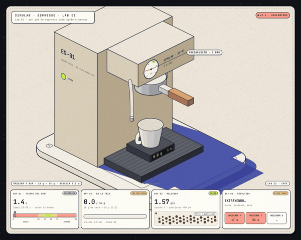
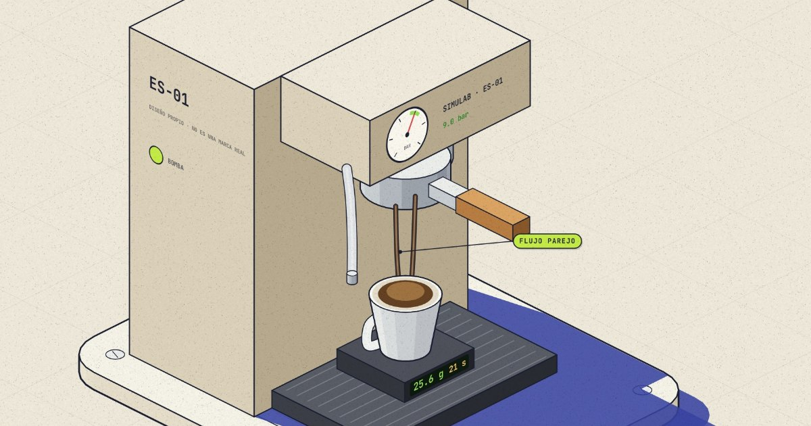
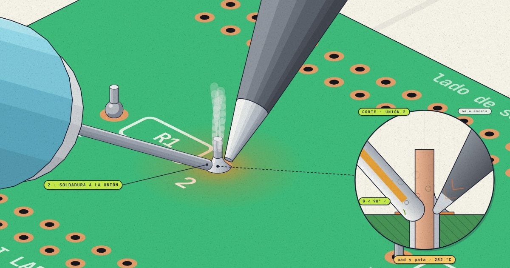
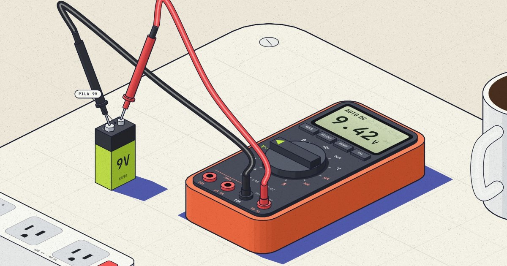
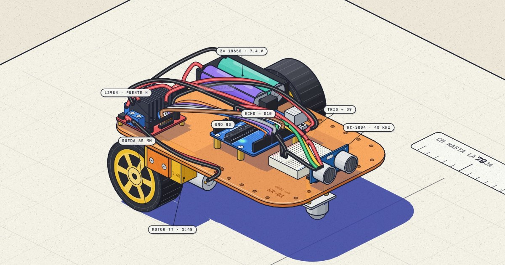
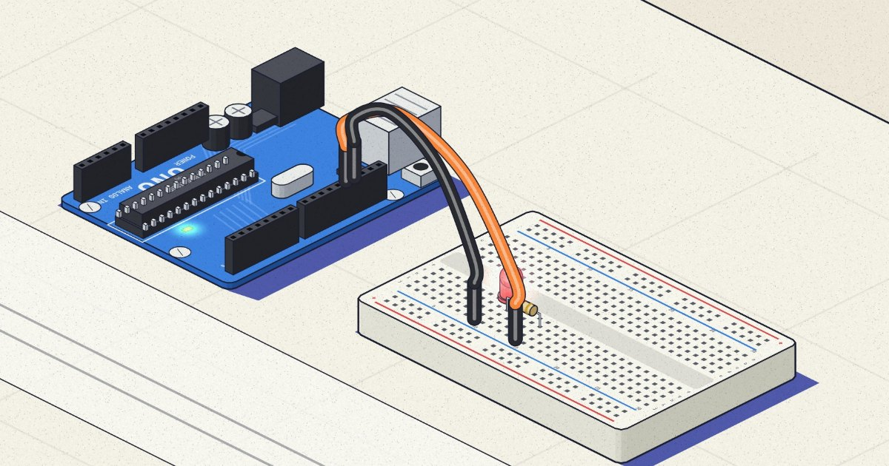
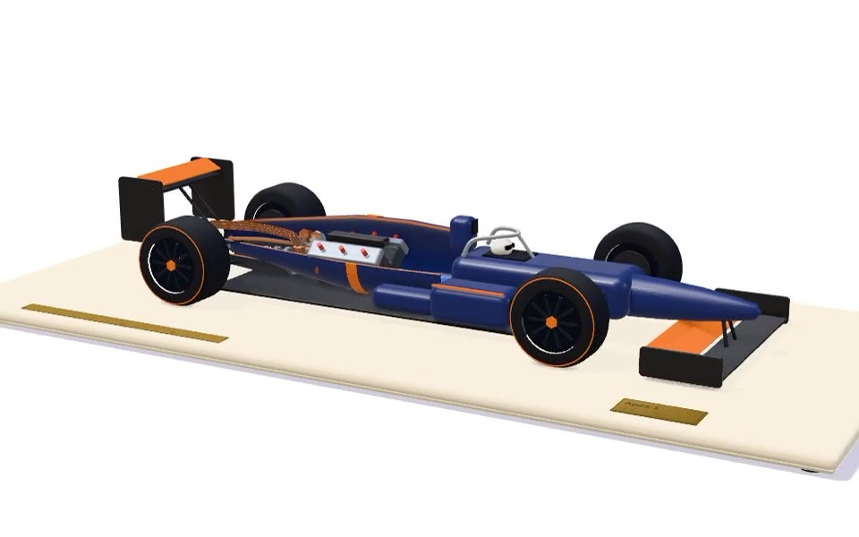

# SIMULAB

**ES** · Un skill de Claude Code que convierte cualquier idea, de cualquier nicho, en un laboratorio 3D interactivo: una página HTML que se arma sola, explica por capítulos y luego te deja romperla. Cada número en pantalla sale de un modelo con fuentes. Con el mismo código saca un video a 60 fps con sonido.

**EN** · A Claude Code skill that turns any idea, from any niche, into an interactive 3D lab: one HTML page that builds itself, explains in chapters and then lets you break it. Every number on screen comes from one sourced model. The same code renders a 60 fps video with sound.



| Café / Coffee | Soldar / Soldering | Multímetro / Multimeter |
|---|---|---|
|  |  |  |
| **Robótica / Robotics** | **Código / Code** | |
|  |  | |

## Modo póster: máquinas reales / Poster mode: real machines

**ES** · Para máquinas con piezas (autos, motores, reactores, aparatos): un póster A4 "HOW IT WORKS" con 3D realista en vivo, un corte para ver por dentro, 6 lecturas en vivo y un loop de 36 s donde la máquina se arma en un segundo y luego se mueve estación por estación. Ejemplo: `demos/lab25-f1`, un F1 con las reglas 2026. `tools/steps.mjs` saca un clip de cada etapa del modelado (bloqueo, gris, malla, cerrado y final) para tutoriales.

**EN** · For machines with parts (cars, engines, reactors, appliances): an A4 "HOW IT WORKS" poster with live realistic 3D, a cutaway, 6 live readouts and a 36 s loop where the machine builds itself in one second and then moves station by station. Example: `demos/lab25-f1`, a Formula 1 car under the 2026 rules. `tools/steps.mjs` renders one clip per modelling stage (blockout, clay, wireframe, closed and final) for tutorials.



```
node tools/build.mjs demos/lab25-f1                                   # -> demos/lab25-f1/dist/index.html
node tools/steps.mjs demos/lab25-f1 --mode=block --t0=33 --az0=-22 --az1=18 --n=72 --w=960
```

Prompts del modo póster: sección 8 de [PROMPTS.md](PROMPTS.md). / Poster-mode prompts: section 8 of [PROMPTS.md](PROMPTS.md).

## Instalar / Install

```
npx skills add ecapri-dev/simulab-skill -g -a claude-code
```

Después, una vez, en la carpeta instalada / Then, once, in the installed folder:

```
cd ~/.claude/skills/simulab && npm install && pip install -r requirements.txt && npx playwright install chromium
```

Necesitas Node.js 20 o más nuevo, Python 3 y Chrome. Para el video, `ffmpeg`. El modo póster usa three.js (MIT), ya incluido en `kit3d/vendor`.
You need Node.js 20 or newer, Python 3 and Chrome. For the video, `ffmpeg`.

## Usar / Use

Pídelo con tus palabras / Ask in plain words:

> /simulab Hazme un lab de por qué se rompe el hilo cuando pescas, con el freno del carrete como perilla.

> /simulab Build a lab on why compound interest matters: coins dropping into jars, starting 5 years earlier.

> /simulab Quiero un lab de cómo se arma una PC, con cada pieza que se coloca sola y un modo práctica.

Los prompts paso a paso están en [PROMPTS.md](PROMPTS.md). / Step-by-step prompts are in [PROMPTS.md](PROMPTS.md).

Abre un ejemplo / Open an example:

```
node tools/build.mjs demos/labE1-espresso    # -> demos/labE1-espresso/dist/index.html
```

## El método en 9 pasos / The method in 9 steps

1. La idea en una pregunta con una pieza que se mueve y un número. / The idea as a question with one moving part and one number.
2. Los números con fuente antes de dibujar; lo demás se marca como supuesto. / Sourced numbers before drawing; the rest is labelled as an assumption.
3. Primero el modelo: funciones puras de una entrada. / Model first: pure functions of one input.
4. Los objetos salen de la librería; lo que falte se agrega una vez. / Objects come from the library; anything missing is added once.
5. Capítulos por contraste: mal, bien, de más. / Chapters by contrast: wrong, right, too much.
6. Déjalo romperse: una perilla y una tecla. / Let them break it: a knob and a key.
7. Revisión con hojas de contacto, no de memoria. / Review on contact sheets, not from memory.
8. Preview y luego video final. / Preview, then the final video.
9. Un solo archivo de menos de 1 MB. / One file under 1 MB.

Todo el detalle está en [SKILL.md](SKILL.md). / The full detail is in [SKILL.md](SKILL.md).

## Qué trae / What is inside

| | |
|---|---|
| `SKILL.md` | Lo que lee Claude: el método, el contrato de cada lab, la revisión. / What Claude reads: the method, the lab contract, the review. |
| `PROMPTS.md` | Prompts en español e inglés y una tabla de ideas por nicho. / Prompts in Spanish and English and a table of ideas by niche. |
| `kit/` | Motor isométrico, interfaz, reproductor e idiomas. / Isometric engine, UI, player and languages. |
| `assets/` | 44 objetos reutilizables (placas, herramientas, café...). Lista en `CATALOGO.md`. / 44 reusable objects (boards, tools, coffee...). List in `CATALOGO.md`. |
| `demos/` | 5 labs completos y el catálogo. / 5 complete labs and the catalogue. |
| `tools/` | Build, hojas de contacto, video, audio, portada. / Build, contact sheets, video, audio, cover. |

## Créditos / Credits

Hecho por [@0xKapri](https://x.com/0xKapri) a partir de su kit KAPRI LAB. Fuentes con SIL Open Font License (`kit/fonts/`).
Made by [@0xKapri](https://x.com/0xKapri) from the KAPRI LAB kit. Fonts under the SIL Open Font License (`kit/fonts/`).

Licencia MIT. / MIT licence.
